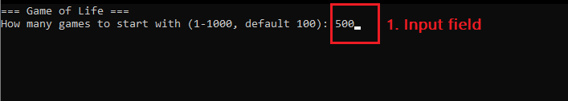
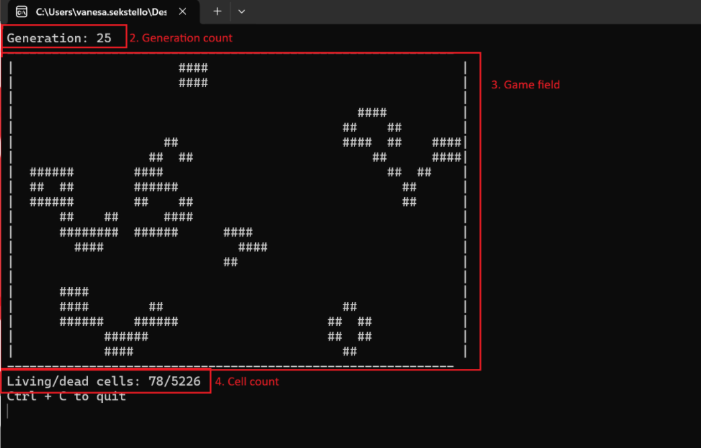
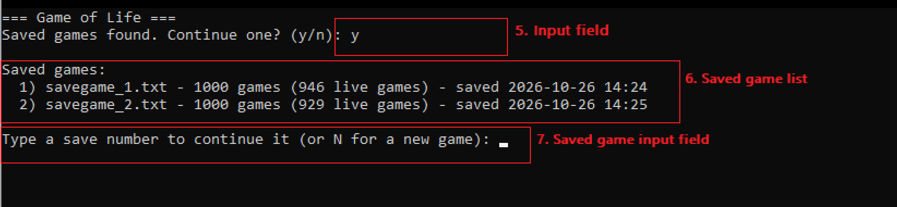

## Terminal Screenshots

### INITIAL MENU

1. Input field: 
    - User may input the amount of desired games to be generated

### RUNNING GAME

2. Game field display:
    - Displays 8 game generations simultaneously,
    - Displays the ID number of each game,
    - Displays information if the game is dead/alive (has any remaining cells), or unmoving (no cell updates)

3. General game information:
    - Displays nth game based on save files of any previous games,
    - Displays amount of live/dead/still games (still containing any cells/not containing any cells/containing unmoving cells, respectively),
    - Displays total amount of living cells

4. Information manual, informs user of keybinds:
    1-8 - picks a slot to display any game of choice based off its id,
    A - adds a number of games based off the users input,
    D - deletes a game based off the users input,
    S - saves current generation of all games to a file that can later be launched again,
    Q - quits the terminal

### SAVED GAME MENU

5. Save input field:
    - Prompts user to choose between launching a saved game or creating a new one

6. Saved game list:
    - Lists all previous saved game files to be choosen

7. Save input field
    - Prompts user to choose between saved games, or create a new game.